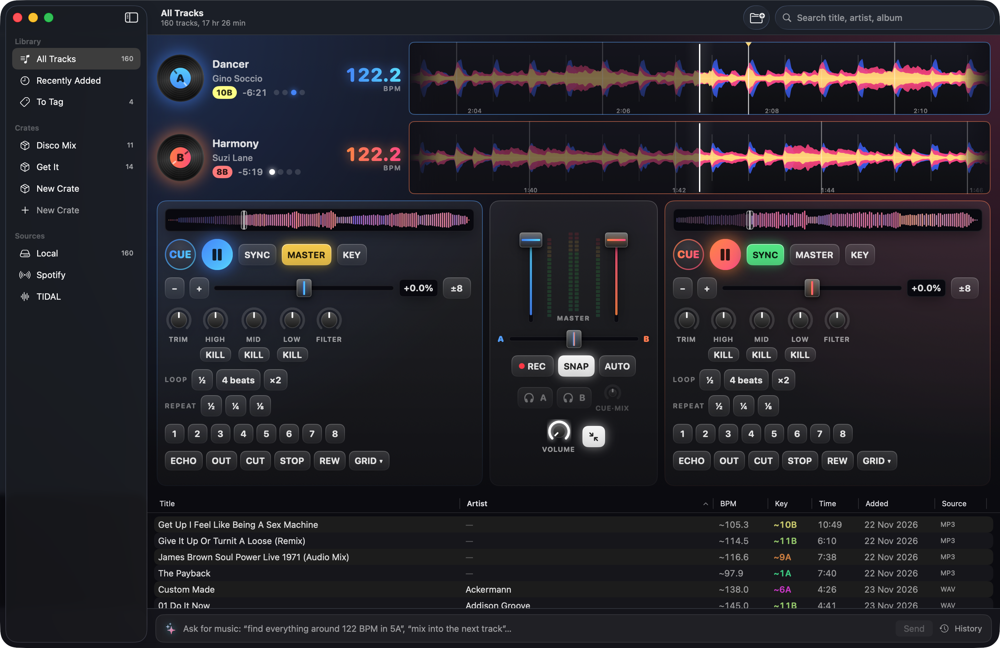
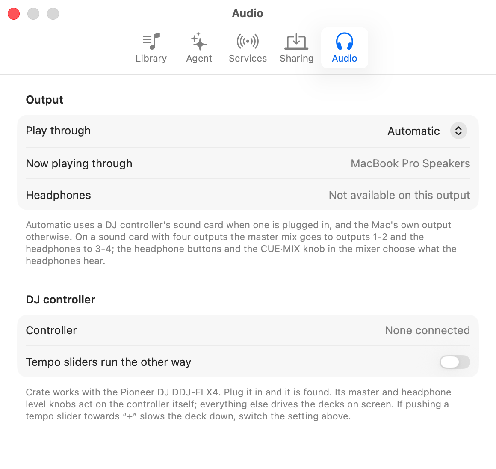
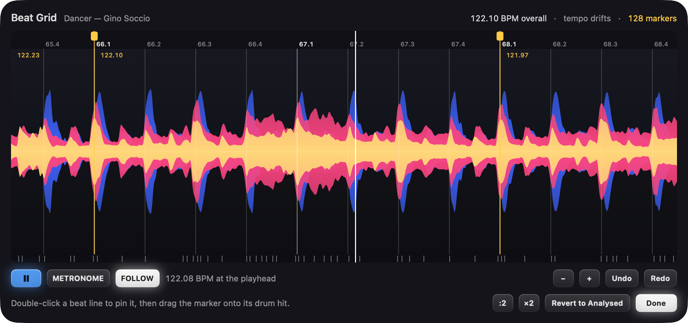

# Crate

A Mac DJ app: a crate browser, two decks you can beat match and mix on, and a built-in agent on the Cursor SDK that can dig through the library and mix for you.


- **Library**: local folders (FLAC, WAV, AIFF, MP3, M4A), with files under a minute skipped as samples. Tracks on external drives stay in the library, dimmed, while the drive is unplugged. The list sorts by two columns at once: the header clicked last leads, and the one clicked before it orders the ties. Click Key and then BPM for tempo order with the keys in Camelot order at each tempo (to the whole BPM); click BPM and then Key for the reverse.
- **DJ data**: BPM and key from tags where present, otherwise estimated by Crate (shown with `~`). Keys are in Camelot notation. Every local track also gets a beat grid and a colour waveform.
- **Decks**: two decks with tempo faders, Sync, key lock or varispeed, a 3-band EQ with kills, a filter, loops, eight hot cues per track, beat-timed echo, tape stop and rewind, a crossfader, and recording of the mix.
- **Waveforms**: each deck's wave scrolls under a fixed playhead (blue is bass, pink is mids, gold is highs) with a line on every beat, so two tracks in time show their beats lined up. The waveform is the record: drag it to scratch.
- **Crates**: ordered playlists. Drag tracks in, or ask the agent.
- **Agent**: ask in plain language ("make a crate of everything from 118 to 124 BPM that mixes with 8A", "mix into Love Sensation with a bass swap", "DJ this crate"). It can search and edit the library, build crates, mix, find audio files on the Mac, search Spotify and TIDAL, and run shell commands after you approve each one.
- **Spotify and TIDAL**: searched through their APIs; tracks play in their own apps. Streaming audio is DRM-protected, so it cannot go on a deck.

## Build and run

Needs Xcode (Swift 5.9+) and [Bun](https://bun.sh).

```sh
./build.sh run        # builds build/Crate.app and launches it
swift test            # 144 tests; the agent bridge tests need ./build.sh to have run once
cd agent && npm run build && npm test   # sidecar protocol tests (Node 22.13+)
```

The app is signed ad hoc. macOS ties privacy permissions and keychain access to the signature, so it may ask again after a rebuild.

## Setting up

1. **Music**: add folders from the empty-library screen, the toolbar, or Settings > Library. Analysis (tempo, key, beat grid, waveform) runs in the background at a few seconds a track.
2. **Agent**: click "Sign In with Cursor" in the agent bar. Requests are billed to your Cursor plan. The agent runs on Claude Opus 4.6 unless you pick another model in Settings > Agent. Settings > Agent also has "Mixing style": how you like mixes done, which the agent reads.
3. **Spotify** (optional): create an app at developer.spotify.com/dashboard with redirect URI `http://127.0.0.1:8888/callback`, then paste its Client ID in Settings > Services and connect. Needs the Spotify desktop app.
4. **TIDAL** (optional): create an app at developer.tidal.com and paste its client ID and secret in Settings > Services. Needs the TIDAL desktop app. Crate can start a TIDAL track but cannot pause it, seek, or read its position.
5. **More tools for the agent** (optional): add MCP servers in Settings > Agent, in the same JSON shape as Cursor's `mcp.json`.

## Using the decks



- **Loading**: nothing about loading touches the disk on the main thread, so a slow or sleeping drive never freezes the window: the deck says "Loading…" until the track lands, and Play pressed meanwhile starts it the moment it does. Drag a track onto a deck, right-click > Load on Deck A/B, or ⌘← / ⌘→ for the selected track. Double-click plays a track if nothing is playing; if a deck is already playing it only loads the other deck, so a slip never cuts a live mix.
- **Sync**: press SYNC on the deck you are bringing in. It takes the other deck's tempo, and pressing play starts it on the beat. Pressed on a deck that is already playing, it jumps onto the beat at once, by less than half a beat. Sync matches beats, not bars: start it on a bar line (the stronger lines) yourself. The master is the deck being followed: the one that was playing first. When it stops, or its track runs out, the deck still playing becomes the master and keeps the job. MASTER picks one by hand. A track whose tempo was read at half or double (67 for 134) still syncs at its own speed.
- **The waveform**: drag to scratch. Two-finger scroll nudges a playing deck ahead or back and scrubs a stopped one. Click a stopped deck to jump there. Pinch or ⌘-scroll zooms both decks.
- **Cue**: as on a CDJ. While playing it returns to the cue point and stops; while stopped it sets the cue point. With SNAP on, cues, loops and jumps land on beats.
- **If the beat lines are off**: the usual case is a grid sitting on the off-beat, with the lines halfway between the kicks. GRID > Move Grid Half a Beat fixes that in one go. The GRID menu also has finer nudges: move the whole grid a few milliseconds, set where the bar starts, halve or double the tempo. GRID > Edit Grid… (or right-click a track > Edit Beat Grid…) opens the grid editor, below.
- **Auto DJ**: AUTO in the mixer. Tracks that are up next get mixed in rather than started cold. About 90 seconds before each mix-out point Crate asks the agent to choose the next track and schedule the mix; if nothing is scheduled 25 seconds out, Crate mixes in the next track itself with a 32-beat bass swap. The ✕ next to the mix status cancels a mix so you can take over.
- **Large decks**: the arrows button beside the mixer's volume knob (or ⇧⌘L) switches to taller waveforms and bigger controls. It grows up to half as big again, as far as the window allows.
- **Recording**: REC writes the mixer's output to `~/Music/Crate Recordings`.
- **Keys** (ignored while typing in a text field):

  | | Cue | Play | Sync | Nudge (hold) | Loop | Loop ½ / ×2 | Hot cues 1–4 |
  |---|---|---|---|---|---|---|---|
  | Deck A | Q | W | E | A / S | Z | X / C | 1 2 3 4 |
  | Deck B | I | O | P | K / L | , | . / / | 7 8 9 0 |

  Space plays or pauses.

## DJ controller and headphones

 Audio">

Crate works with the **Pioneer DJ DDJ-FLX4**: as its sound card, with headphone monitoring, and as the controller. Plug it in; nothing needs setting up.

- **Sound**: the master mix goes to the controller's master output, the headphones to its headphone socket. Settings > Audio chooses the output; Automatic uses the controller when it is plugged in and the Mac's own output when it is not. The controller's MASTER LEVEL and HEADPHONES LEVEL knobs work on the controller itself.
- **Headphone cue**: the CUE button over each channel fader (or the headphone buttons in Crate's mixer) puts that deck in the headphones before its fader is up. HEADPHONES MIXING (CUE·MIX on screen) blends from the cued decks to the master mix. Cue and master reach the headphones in step, so beats can be matched by ear.
- **Decks**: play, cue, beat sync (hold it to make the deck the tempo master), tempo sliders, jog wheels (hand on top to scratch, the edge to nudge, with SHIFT to search), loop IN and OUT (hold IN for a four-beat loop), RELOOP/EXIT, and ½X / 2X.
- **Pads**: HOT CUE (SHIFT + pad clears one), BEAT LOOP (¼ to 32 beats) and BEAT JUMP (1 to 8 beats either way).
- **Mixer**: trim, three-band EQ, CFX as the filter, channel faders, crossfader.
- **Browse**: the knob moves through the track list, LOAD puts the selected track on a deck, pressing the knob loads it on the free deck, and SHIFT + the knob zooms the waveforms.
- **Beat FX**: ON/OFF is the echo for the chosen channel; BEAT ◀ ▶ halve and double its time.
- **Lights** follow the decks: play, cue, sync, headphone cue, loops, hot cues, and the channel level meters.
- A tempo slider only takes hold of a deck's tempo once it has been moved to where the tempo already is, so a slider left elsewhere cannot make the tempo jump. A synced deck ignores its slider.

Not mapped: SMART CFX, SMART FADER, the sampler, keyboard and pad FX modes, and the Beat FX level knob.

Any sound card with four outputs gets the same headphone monitoring (master on outputs 1-2, headphones on 3-4), with the cue buttons in Crate's mixer.

## Sharing between your Macs

One library on all your Macs, with no server and no account. Each Mac keeps its own copy; whenever two of them can see each other with Crate open, they bring each other up to date.

**Setting up** (Settings > Sharing, on each Mac):

1. Turn on "Share this library with my other Macs" and give the Mac a name.
2. On the first Mac press Make a Code. On the others, type that code in. Only copies of Crate with the same code can connect.
3. With Tailscale running, the Macs find each other, at home or away. A Mac that Tailscale does not list can be added by address.

**What is shared**

- **Playlists and track details**: crates, titles, BPM, key, notes, cue points and beat grids. Edit on one Mac and it appears on the others.
- **Music files, when wanted**: every Mac lists every track. One whose file is on another Mac shows that Mac's name in the Source column. Loading or playing it copies the file here first (the deck says "Fetching from Studio… 40%"), and it stays. Right-click > Copy to This Mac does the same for a selection.
- **Keep on This Mac** (right-click a crate): its tracks are copied ahead of time, including ones added to it later.
- Copied files go to `~/Music/Crate` unless you choose another folder, filed by artist.

**When two Macs disagree**

- A track's details, and its cue points: the latest change wins.
- A beat grid you corrected by hand beats one made by analysis, whichever is newer.
- A crate changed on one Mac only: that change is taken. Changed on both while they were apart: both are kept, the earlier as "Name (that Mac's name)".
- Remove from Library removes the track on every Mac; it never deletes a music file. A crate deleted on one Mac is deleted on the others unless it was changed there meanwhile.

## Editing a beat grid



The grid editor works like Ableton's warp markers, with one difference: nothing is stretched. Markers only record where the beats are in the audio; Sync and the AI's mixes then follow them.

- **Markers** are yellow. Each pins one beat to a moment in the audio. The beats between two markers are spaced evenly, and the tempo of each stretch is shown beside its marker.
- **Add** a marker by double-clicking a beat line. **Move** it by dragging; it snaps to nearby drum hits (the ticks along the bottom), or hold Shift to place it freely. **Remove** it by double-clicking it or pressing Delete.
- **With a marker selected**: Seg. BPM sets the tempo from that marker to the next; Set 1.1.1 Here makes it the first beat of a bar; Warp From Here (Straight) gives the rest of the track one fixed tempo.
- **Metronome** clicks on every beat of the grid, higher on the first beat of each bar. It is the way to hear whether the grid sits on the drums.
- Click the waveform to move the playhead, drag it or scroll to move the view, pinch or ⌘-scroll to zoom. Space plays and pauses. ⌘Z undoes, and Revert to Analysed finds the beats afresh.
- Analysis places markers itself: two for a track with a fixed tempo, one every few bars for a drummer who drifts. An edited grid is never overwritten by re-analysis.

## How it fits together

```
Crate.app (Swift, SwiftUI)                         agent sidecar (TypeScript, compiled with Bun)
  UI · library (SQLite) · analysis · decks · mixing   @cursor/sdk local agent
  ToolRegistry: every agent tool lives here    <-->  forwards tool calls over stdin/stdout JSON lines
```

- `Sources/CrateDSP` — one deck's audio core, in C: everything that runs on the audio thread (variable-speed playback in both directions, loops, EQ, filter, echo, sample-accurate scheduled commands). No allocation, locks or Swift runtime while rendering.
- `Sources/CrateCore` — everything else that is not UI, and what the tests cover:
  - `Library/` — database, scanner, tags, Camelot keys.
  - `Analysis/` — tempo, key, waveform and beat grids. `SteadyTempo` handles music with a fixed tempo (most dance music): it measures the exact beat length from all the drum hits in the track at once, so a breakdown cannot make it lose count, and puts the grid on the kick. `BeatTracker` falls back to finding the beats one by one for a band playing live. `BeatGrid` holds the beats and their markers, and every edit the grid editor makes. When the tracker improves, `BeatTracker.version` goes up and grids made by the older one are made again in the background.
  - `Controller/` — the DDJ-FLX4 as MIDI: what each message means (`DDJFLX4.Decoder`) and the message for each light.
  - `Audio/` — `Deck` and `DeckEngine` (two decks into a mixer on `AVAudioEngine`). The whole path carries four channels: the master mix and what the headphones hear, rendered together so they stay in step. `AudioDevices` lists and picks the output. An engine can run offline and render audio instead of playing it, which is how timing is tested.
  - `Mix/` — `DeckSync` (keeps a deck on the master's beat), `Transition` and `TransitionRunner` (a mix described as data and carried out on the beat), `TrackStructure` (a track's shape in 8-bar phrases).
  - `Agent/` — bridge, tool registry, tools. `DeckTools.swift` has the mixing tools.
  - `Services/` — Spotify, TIDAL.
  - `Sync/` — sharing between Macs. `Fingerprint` gives a file the same identity on every Mac (its size and a hash of its first and last megabyte). `SyncRecords` holds what two Macs say to each other and `SyncRules` which side wins; `SyncStore` is the library's end of it. `SyncSession` runs one conversation over a `PeerChannel`: in memory for tests, `NetworkChannel` (TCP with TLS keyed by the sharing code) for real. `SyncService` listens, calls the other Macs (found through `Tailscale`) and fetches files (`FileTransfer`).
- `Sources/Crate` — the app. `Decks/` holds the deck and mixer models, `MixDirector` (turns a mix request into a transition; runs the auto DJ) and the keyboard shortcuts. `UI/Decks/` is the decks' interface.
- `Scripts/make-icon.sh` — redraws the app icon (`Resources/AppIcon.icns`) from `Scripts/make-icon.swift`.
- `agent/` — the sidecar. It holds no music logic: the app sends it the tool catalogue and it forwards each call back. `src/protocol.ts` defines the messages.

### How the AI mixes

A language model answers in seconds, so it cannot ride a fader. It chooses: which track, where the mix starts, how long, which style (`bass_swap`, `blend`, `filter`, `echo_out`, `cut`, `tape_stop`). `mix_transition` hands that to the transition runner, which starts the new track on the exact frame of the beat, keeps the two in time and moves faders and EQ as the beats go by. `track_structure` is how the agent sees a track: bass, mids and highs per 8-bar phrase, with suggested points to mix in and out.

### What the agent may do

The Cursor SDK's built-in shell, edit, write and delete tools are switched off; it keeps read-only file tools and web search. Everything else is a Crate tool. `track_update` changes Crate's database only, never an audio file. `run_command` shows the exact command and the agent's reason and runs only on approval. The agent does not load the MCP servers configured for the Cursor editor.

## Development aids

- `CRATE_FAKE_SDK=1` swaps the Cursor SDK for an offline stand-in (no network, no cost). It is not an AI: plain text runs a library search, and `/tool <name> <json>` calls one tool.
- `CRATE_DB=<path>` uses a different library file and keeps credentials in memory instead of the keychain.
- `CRATE_DEBUG='volume:0.05;load:A:3;deck:A:play;wait:5;decks;snapshot:/tmp/crate.png;quit'` scripts the running app; see `Sources/Crate/DebugDriver.swift`. The `stall` step prints the longest the main thread has stood still since it was last asked: the check that nothing (loading a track above all) holds up the interface. The `snapshot` step photographs Crate's own window, which needs no screen-recording permission; `settings:audio` opens Settings on a tab and `snapshot:<path>:settings` photographs that window. The pictures in `docs/screenshots` were made this way.
- `CRATE_FAKE_CONTROLLER=1` adds a pretend DDJ-FLX4 as a MIDI device, so the controller link can be tried without one: in a `CRATE_DEBUG` script, `midi:90 0B 7F` presses deck 1's play button and `controller` prints what Crate did and which lights it lit.
- `CRATE_EVAL_DB=<library> swift test --filter RealTrackEvaluation` measures the beat tracker on a real library. Adding `CRATE_EVAL_MIX=<out.wav>` with `--filter RealMixEvaluation` renders a synced blend of two tracks and measures how well their drums line up. With `CRATE_EVAL_CACHE=<folder>` (decoded audio is kept there between runs) and `-c release`: `--filter KickMapEvaluation` prints, along each track, whether the kicks fall on the grid's beats or between them; `--filter SteadyTempoEvaluation` prints the fixed-tempo fits; `CRATE_EVAL_PAIRS=12:7,… --filter RealPairEvaluation` compares old and new grids on synced pairs of tracks, kick against kick.

- Two copies of Crate on one Mac can share with each other, each with its own `CRATE_DB`, `CRATE_SYNC_NAME`, `CRATE_SYNC_PORT` and `CRATE_SYNC_FOLDER`, the same `CRATE_SYNC_SECRET`, and one of them with `CRATE_SYNC_PEERS=127.0.0.1:<the other's port>`.

```sh
CRATE_DB=/tmp/test.sqlite CRATE_FAKE_SDK=1 ./build/Crate.app/Contents/MacOS/Crate
```

## Known limits

- **Beat grids are estimates.** For music with a fixed tempo the grid is exact to a millisecond or two, but which of the kick and the off-beat is "the beat" is judged from the bass and from where the file starts; in broken-beat styles (garage, breaks, trap) that judgement can be wrong, and GRID > Move Grid Half a Beat puts it right. For a band playing live the grid follows the drummer to within about 5 ms on average and 20 ms at worst, so two live tracks in Sync can flam now and then. Which beat starts the bar, and where phrases start, are weaker guesses still.
- **Sync matches beats, not bars.** A mix scheduled by the agent or the auto DJ starts on bar lines; by hand, that is up to you.
- **Key lock** uses Apple's pitch shifter, which softens drum attacks a little and makes that deck answer its controls about 80 ms late. Varispeed (key lock off) has neither cost.
- **Sharing needs Crate open on both Macs**, and a file is copied whole before it plays, so the first load of a track from another Mac takes as long as the copy does. "Latest" is judged by the Macs' clocks. A file whose tags were edited outside Crate is a different file to the other Macs. A removed track comes back if its file is still in a library folder that is scanned again, as on a single Mac. macOS may ask whether Crate may accept incoming connections, and again after each rebuild.
- **One controller.** Only the DDJ-FLX4 is mapped, from its published MIDI list; other controllers are not recognised. There is no microphone or line input.
- BPM and key estimates are approximate. Tempo can come out at half or double; key detection is unreliable on percussive or off-pitch material.
- A deck holds its whole track in memory: about 20 MB a minute.
- A recording can be missing its last tenth of a second or two.
- No rekordbox or Traktor import. Streaming tracks can only be added through the agent's search, and Spotify provides no BPM or key.
