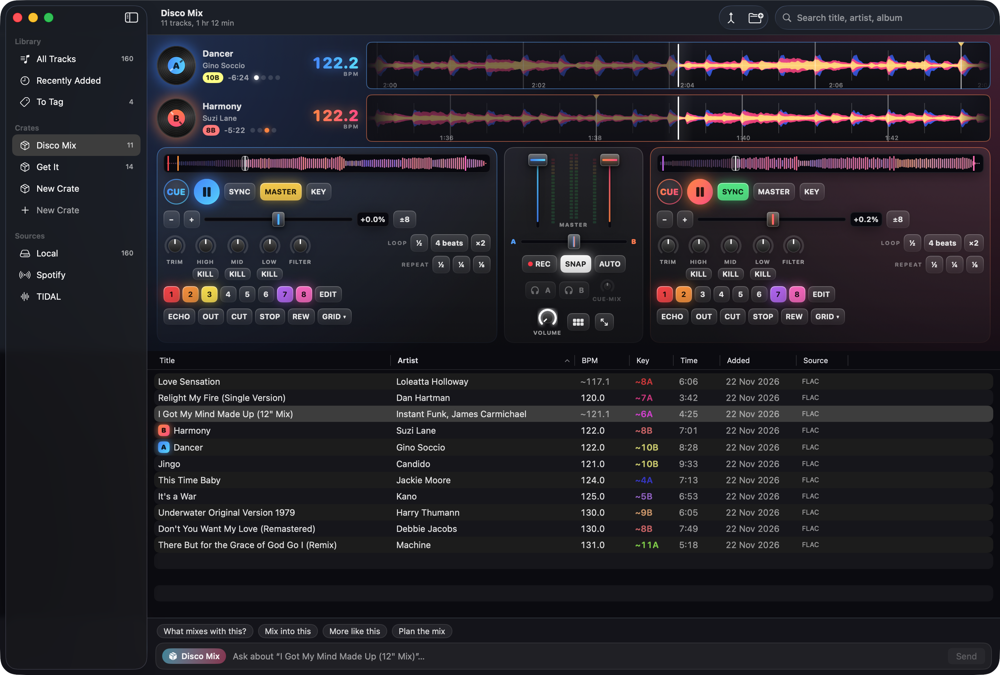
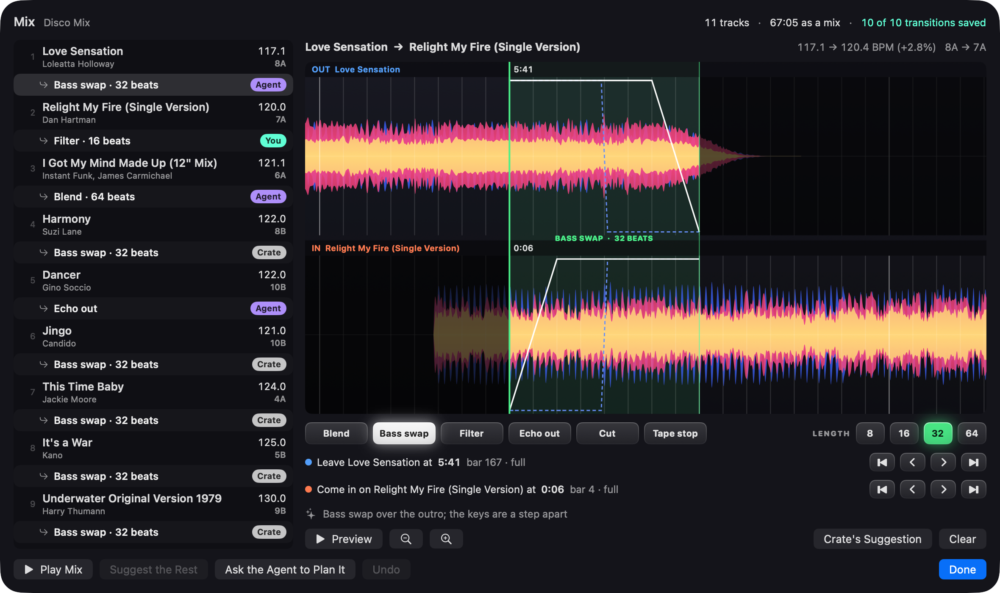
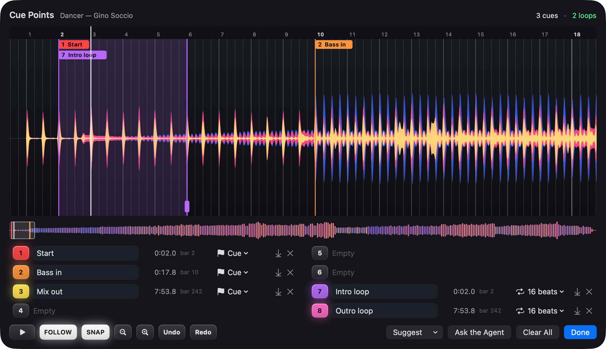
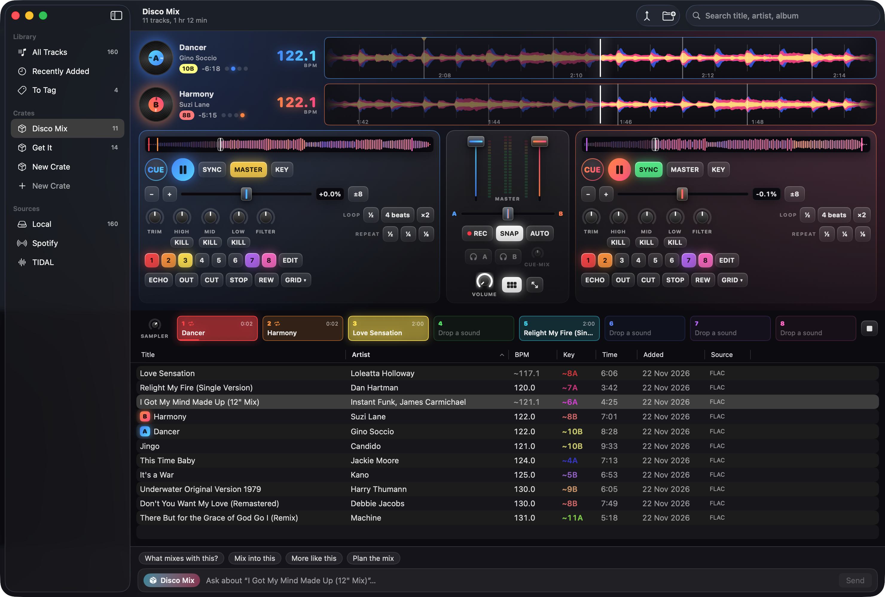

# Crate

A Mac DJ app: a crate browser, two decks you can beat match and mix on, and a built-in agent on the Cursor SDK that can dig through the library and mix for you.



- **Library**: local folders (FLAC, WAV, AIFF, MP3, M4A), with files under a minute skipped as samples. Tracks on external drives stay in the library, dimmed, while the drive is unplugged. The list sorts by two columns at once: the header clicked last leads, and the one clicked before it orders the ties. Click Key and then BPM for tempo order with the keys in Camelot order at each tempo (to the whole BPM); click BPM and then Key for the reverse.
- **DJ data**: BPM and key from tags where present, otherwise estimated by Crate (shown with `~`). Keys are in Camelot notation. Every local track also gets a beat grid and a colour waveform.
- **Decks**: two decks with tempo faders, Sync, key lock or varispeed, a 3-band EQ with kills, a filter, loops, eight hot cues per track, beat-timed echo, tape stop and rewind, a crossfader, and recording of the mix.
- **Waveforms**: each deck's wave scrolls under a fixed playhead (blue is bass, pink is mids, gold is highs) with a line on every beat, so two tracks in time show their beats lined up. The waveform is the record: drag it to scratch.
- **Crates**: ordered playlists. Drag tracks in, or ask the agent.
- **Mix history**: every session at the decks, with the tracks in the order played and what each was mixed in from. A session can be saved as a crate.
- **Agent**: ask in plain language ("make a crate of everything from 118 to 124 BPM that mixes with 8A", "mix into Love Sensation with a bass swap", "DJ this crate"). It can search and edit the library, build crates, mix, find audio files on the Mac, search Spotify and TIDAL, download tracks from TIDAL with tiddl, and run shell commands, the last two after you approve each one.
- **Spotify and TIDAL**: searched through their APIs; tracks play in their own apps. Streaming audio is DRM-protected, so it cannot go on a deck.

## Build and run

Needs Xcode (Swift 5.9+) and [Bun](https://bun.sh).

```sh
./build.sh run        # builds build/Crate.app and launches it
swift test            # 168 tests; the agent bridge tests need ./build.sh to have run once
cd agent && npm run build && npm test   # sidecar protocol tests (Node 22.13+)
```

The app is signed ad hoc. macOS ties privacy permissions and keychain access to the signature, so it may ask again after a rebuild.

## Setting up

1. **Music**: add folders from the empty-library screen, the toolbar, or Settings > Library. Analysis (tempo, key, beat grid, waveform) runs in the background at a few seconds a track.
2. **Agent**: click "Sign In with Cursor" in the agent bar. Requests are billed to your Cursor plan. The agent runs on Claude Opus 4.6 unless you pick another model in Settings > Agent. Settings > Agent also has "Mixing style": how you like mixes done, which the agent reads.
3. **Spotify** (optional): create an app at developer.spotify.com/dashboard with redirect URI `http://127.0.0.1:8888/callback`, then paste its Client ID in Settings > Services and connect. Needs the Spotify desktop app.
4. **TIDAL** (optional): create an app at developer.tidal.com and paste its client ID and secret in Settings > Services. Needs the TIDAL desktop app. Crate can start a TIDAL track but cannot pause it, seek, or read its position.
5. **More tools for the agent** (optional): add MCP servers in Settings > Agent, in the same JSON shape as Cursor's `mcp.json`.

## Using the decks


- **Loading**: nothing about loading touches the disk on the main thread, so a slow or sleeping drive never freezes the window: the deck says "Loading…" until the track lands, and Play pressed meanwhile starts it the moment it does. Drag a track onto a deck, right-click > Load on Deck A/B, or ⌘← / ⌘→ for the selected track. Double-click plays a track if nothing is playing; if a deck is already playing it only loads the other deck, so a slip never cuts a live mix.
- **Sync**: press SYNC on the deck you are bringing in. It takes the other deck's tempo, and pressing play starts it on the beat. Pressed on a deck that is already playing, it jumps onto the beat at once, by less than half a beat. Sync matches beats, not bars: start it on a bar line (the stronger lines) yourself. The master is the deck being followed: the one that was playing first. When it stops, or its track runs out, the deck still playing becomes the master and keeps the job. MASTER picks one by hand. A track whose tempo was read at half or double (67 for 134) still syncs at its own speed.
- **The waveform**: drag to scratch. Two-finger scroll nudges a playing deck ahead or back and scrubs a stopped one. Click a stopped deck to jump there. Pinch or ⌘-scroll zooms both decks.
- **Cue**: as on a CDJ. Hold it on a stopped deck and the track plays from the cue point for as long as it is held; let go and the deck is back on the cue point, stopped. Press Play while holding it, or hold it for more than five seconds, and the deck carries on when it is let go. While playing, Cue returns to the cue point and stops. On a deck stopped somewhere else, it moves the cue point there first. The on-screen button, the Q and I keys and the controller's CUE buttons all work this way. With SNAP on, cues, loops and jumps land on beats.
- **Loops** are drawn unrolled on the scrolling wave: each pass of the loop follows the last, so the wave keeps scrolling at the loop's end where the deck itself drops back to the start. Behind the playhead are the passes already played, and before them the track that led into the loop; ahead are the passes to come, so what follows the loop comes back into view when the loop is let go. The strip of the whole track still shows where the deck really is.
- **If the beat lines are off**: the usual case is a grid sitting on the off-beat, with the lines halfway between the kicks. GRID > Move Grid Half a Beat fixes that in one go. The GRID menu also has finer nudges: move the whole grid a few milliseconds, set where the bar starts, halve or double the tempo. GRID > Edit Grid… (or right-click a track > Edit Beat Grid…) opens the grid editor, below.
- **Auto DJ**: AUTO in the mixer. Tracks that are up next get mixed in rather than started cold. About 90 seconds before each mix-out point Crate asks the agent to choose the next track and schedule the mix; if nothing is scheduled 25 seconds out, Crate mixes in the next track itself with a 32-beat bass swap. The ✕ next to the mix status cancels a mix so you can take over.
- **Large decks**: the arrows button in the mixer (or ⇧⌘L) switches to taller waveforms and bigger controls. It grows up to half as big again, as far as the window allows.
- **Recording**: REC writes the mixer's output to `~/Music/Crate Recordings`.
- **Meters**: the meter beside each channel fader shows that deck before its fader, so two tracks can be matched with TRIM before one is brought in. The pair in the middle is the master mix, left and right, marked in decibels below full scale. Green runs up to -8 dB and amber to full scale; red is over it. A light stays on for a moment at the loudest recent peak. When the master goes into the red its label reads LIMIT: the limiter is holding the mix back, so turn a trim, a fader or the volume down.
- **Keys** (ignored while typing in a text field):

  | | Cue | Play | Sync | Nudge (hold) | Loop | Loop ½ / ×2 | Hot cues 1–4 |
  |---|---|---|---|---|---|---|---|
  | Deck A | Q | W | E | A / S | Z | X / C | 1 2 3 4 |
  | Deck B | I | O | P | K / L | , | . / / | 7 8 9 0 |

  Space plays or pauses.

## A crate as a mix



A crate can carry a mix: for each track going into the next, a saved transition. Open the mix editor with the Mix button in the toolbar while a crate is on screen, or "Edit Mix…" on a crate.

- **The crate, top to bottom** is on the left, with how each track goes into the next: the style, the length, and who set it (You, the Agent, or Crate). A pair with nothing saved shows what Crate would do.
- **One transition** is laid out on the right as two waveforms in step: the track being left above, the one coming in below, and the stretch where both play shaded. The white line is each track's fader through the mix and the dashed blue line its bass. Drag the upper waveform to move where the first track is left, the lower to move where the next comes in; they move a bar at a time. The arrows beside "Leave" and "Come in on" do the same by a bar or eight.
- **Styles**: blend, bass swap, filter, echo out, cut, tape stop. **Length**: 8, 16, 32 or 64 beats for the styles that overlap. Anything changed is saved with the crate at once; Undo steps back.
- **Preview** plays the first track from two bars before the mix and then the mix itself, on the two decks, so it needs both decks free.
- **Suggest the Rest** saves Crate's own transition for every pair without one: out where the first track thins, in where the next begins, a 32-beat bass swap when the tempos are close and an echo out when they are not.
- **Ask the Agent to Plan It**, or "plan a mix of this crate" in the agent bar: the agent orders the crate, looks at each track's structure and saves a transition for every pair, with a note on each saying why. It keeps the ones you set. Its tools are `mix_plan`, `mix_plan_set` and `mix_plan_clear`.
- **Play Mix** (in the editor, or on a crate's menu) plays the crate from the top, each track going into the next as saved. Nothing is asked of the agent while it plays, so it costs nothing and goes the same way every time. Where a pair has nothing saved, Crate mixes its own way.
- A saved transition is also followed whenever those two tracks follow each other with AUTO on.
- The mix is kept on this Mac; it is not yet shared with your other Macs. Reordering the crate keeps the transitions of pairs that are still neighbours.

## Exporting to rekordbox

Right-click a crate and choose **Export for rekordbox…**, or use **File > Export All Crates for rekordbox…**. Crate writes a rekordbox XML library file: each crate as a playlist in the crate's order, and for every track its title, artist, album, tempo, key, beat grid, and its hot cues and saved loops with their names and pad colours (pad 1 is hot cue A). The music is not copied; the file points at each track where it is on this Mac.

In rekordbox, choose the file under Preferences > Advanced > Database > rekordbox xml, open "rekordbox xml" in the tree on the left (turn it on under Preferences > View > Layout if it is not there), and drag the playlist into Playlists. All crates together arrive in one folder called "Crate".

- A track with a steady tempo is one grid in rekordbox. A track whose tempo moves, as a live drummer's does, is exported with a tempo for each stretch between Crate's grid markers.
- Streaming tracks and tracks whose file is only on another Mac are left out, and the export says how many.
- A crate's planned mix (its transitions) has no place in rekordbox and is not exported.
- The export has been checked against Pioneer's published format, not yet in rekordbox itself. MP3s are worth a look after importing: players do not all agree on where an MP3 starts, which can put a grid and its cues a few hundredths of a second out.

## Grabbing tracks from TIDAL

A streaming track cannot go on a deck. **File > Grab from TIDAL…** (⇧⌘T, or the arrow button in the toolbar) downloads tracks as files and adds them to the library, using [tiddl](https://github.com/oskvr37/tiddl), a separate command-line tool that signs in with your own TIDAL account. Crate does not include tiddl: install it (`uv tool install tiddl` or `pipx install tiddl`), sign in once in Terminal with `tiddl auth login`, and Crate finds it. tiddl needs ffmpeg (`brew install ffmpeg`).

1. Type or paste what you want, one to a line: an artist and title, or a TIDAL link to a track, an album or a playlist. A pasted tracklist works: numbers and times at the start of a line are ignored.
2. **Find on TIDAL** lists the matches for each line, each with its version, album and length, and chooses TIDAL's best. Check them: the best match is often a radio edit, a remaster or a live recording, and the menu on each row has the others. A line TIDAL has nothing like is left unchosen, with its nearest matches to pick from if one is right.
3. **Grab** downloads the chosen tracks, FLAC where TIDAL has it, and adds them to the library and to the crate you picked. They are analysed like any other file.

- Files go to `~/Music/tiddl`, in folders by artist and album, which is where tiddl puts them itself. The folder and the quality are in Settings > Services. The folder becomes a library folder.
- A track that is already downloaded is not downloaded again: its file is found and used.
- A file is named after its title and version ("Love Hangover (Single Version).flac"). tiddl's own default leaves the version out, which would make two versions from one album the same file. If you have set file names yourself in tiddl's `config.toml`, Crate uses yours.
- **TIDAL tracks already in the library**: right-click and choose **Grab from TIDAL**. The file takes the streaming track's place in every crate it is in, at the same position, and keeps its notes. For a Spotify track, or a track whose file is missing, **Find on TIDAL to Grab…** opens the sheet with it looked up.
- **The agent** can do the same when asked ("grab the extended mix of Paradise by Change into this crate"): it searches with `tiddl_search`, and `tiddl_grab` shows you the tracks by name and the command, and downloads only if you approve.
- Searching and working out where a file will land go through tiddl's own Python code, written against tiddl 3.4; a much later tiddl may need Crate updating. Downloading uses tiddl's command line.

## Mix history

**Mix History** in the sidebar is the record of what you have played: every session at the decks, the latest first, with its tracks in the order they went out and the time each one did.

- **What counts as played**: a track that has been in the mix for half a minute, meaning playing with its fader up and the crossfader letting it through. A track that was only loaded, cued up, tried in the headphones or held on Cue is not in the history. A Spotify or TIDAL track played through its own app counts too.
- **What it was mixed in from**: the merge mark beside a track means it came in while the track above it was still playing, or within a few seconds of it stopping. A track with no mark was started cold.
- **Sessions**: a track played more than an hour after the one before starts a new session.
- **Save as Crate** on a session makes a crate of its tracks in the order played, which the mix editor can then turn into a planned mix. Right-click a track to load it on a deck, show it in the library, add it to a crate or remove it from the history; double-click loads it on the free deck without interrupting what is playing. The "…" on a session deletes that session's record (never the tracks).
- **The agent** can read it (`mix_history`): "what did I play last night?", "make a crate of Saturday's set", "what have I mixed this into before?".
- The history is kept on this Mac; it is not shared between Macs.

## Cue points and saved loops



Each track has eight pads. A pad holds a hot cue (a place to jump to) or a saved loop (a place that goes round when its pad is hit). Hitting a pad plays from its cue: a playing deck jumps there, and a stopped one starts from there. A pad that holds a plain cue also takes the deck out of any loop it is in; a pad that holds a saved loop puts it into that one. Hitting an empty pad sets a cue where the deck is and leaves the deck as it was.

- **The cue editor** opens from EDIT at the end of a deck's pads, or "Edit Cue Points…" on a track. The pads are flags along the waveform: drag one to move it, drag a loop's far edge to change its length, double-click the wave to put a cue there, double-click a flag to play from it. Everything lands on the beat while SNAP is on; hold Shift to place one freely. The rows underneath name each pad, turn it into a loop of 1 to 32 beats, move it to the playhead or clear it. Undo and Redo cover every change.
- **Suggest** fills the empty pads from the track's shape: where it starts, where the bass comes in, each breakdown and the drop after it, where the outro begins, and four-bar loops at each end for mixing in and out. It is instant and costs nothing, and it is only as right as the beat grid, so check it by ear.
- **Ask the Agent** has the agent do the same with more thought. It can read a track's structure and its cues and set or clear them (`cue_points`, `cue_set`, `cue_clear`), so "set cues for everything in this crate" or "put a loop on the last four bars of the intro" work from the agent bar too. It cannot hear the music; it works from Crate's analysis.
- Cue names and saved loops are shared between your Macs with the rest of a track's cues.

## Sampler



Each deck has a **sample bank** of eight pads, in two rows under the decks: deck A's above, deck B's below. Each pad is either a **one-shot** or a **mini deck**. Show the sampler with the grid button in the mixer, or ⇧⌘S.

- **Banks** are named sets of eight pads, and there can be as many as you like. The label at the start of a row names the bank that deck has up; click it for the others, and for New, Duplicate, Rename and Delete. A bank is up on one deck at a time. Changing what is on a pad changes the bank.
- **A bank can go with a track.** With a track on the deck, choose "Bring This Bank Up with …" in the bank's menu (a link mark then shows on the label). From then on, loading that track on either deck brings the bank up there. One bank can go with many tracks; a track has one bank. A track with no bank leaves the deck's bank as it is. If pads of that deck are sounding when the track is loaded, the bank waits until they stop, so loading a track never cuts off a loop.

- **A one-shot** plays from the top every time it is hit: a horn, a vocal stab, a drum hit.
- **A mini deck** plays a loop round and round until it is hit again. It shows the loop's waveform with a playhead moving across it and, where a deck shows its BPM, the loop's tempo: lit while it follows the decks, and then the tempo it is being played at. It keeps time with the decks (Sync, below).
- **Which a pad is** is "Plays as" in its right-click menu. A loop taken from a deck is a mini deck; so is a file whose name says it is a loop ("loop", or a tempo such as "124bpm"). Anything else starts as a one-shot.

- **Loading a pad**: drag an audio file from the Finder or a track from the list onto it, click an empty pad to choose a file, or right-click a track and "Send to Sampler". A pad takes at most the first two minutes of a file, and any audio file will do, including the short ones the library leaves out. "Send to Sampler" lists both decks' banks.
- **Taking a loop from a deck**: right-click a pad and "Take the Loop from Deck A". It takes what the deck is looping, or four beats from where it is, and plays it as a loop.
- **Playing**: a pad sounds as the mouse goes down. The square button stops everything. Right-click a pad for what it plays as, its level, and Clear.
- **In the mix**: the sampler has its own level knob and goes straight to the master, past the crossfader. With a four-output sound card the headphone button sends it to the headphones whatever its level.
- **On the DDJ-FLX4**: in SAMPLER pad mode the left side's pads play deck A's bank and the right side's deck B's; SHIFT + pad stops one.
- **Quantize** (the Q button in the sampler) puts every pad hit on the grid of the deck that is playing. Right-click it for the grid: a quarter or half of a beat, a beat, or a bar, counted from the track's own bar lines. A loop goes to the nearest line: hit just before one and it waits for it; hit just after and it comes in at once, as far in as it would have got. On the bar grid that means a loop always sits where the track's bar is, wherever in the bar it was hit, so long as the track's beat grid has the bar right. A one-shot is never started part-way through: it waits for the next line and plays whole (by the beat at most, even on the bar grid), or sounds at once if the line went by less than a fiftieth of a second ago. With no deck playing, a hit sounds at once.
- **Sync** (the metronome mark on a pad) is for loops: the loop is played at the tempo of the deck that is playing and held on its beat from then on, through tempo changes, nudges and tracks whose tempo drifts. Its pitch moves with its speed, as a record's does. Every mini deck starts with Sync on; "Sync to the Decks' Tempo" in the pad's menu turns it off for a loop that should run at its own speed. A synced loop starts on a beat even with Quantize off, since it is held there anyway.
- **A loop's tempo** is the one in the file's name if it has one ("Drum Loop 124bpm"). Otherwise it comes from its length: a loop file is cut to a whole number of beats, and Crate takes the count (1, 2, 4, 8 and so on) that puts it between 80 and 160 BPM. A loop taken from a deck, or a library track put on a pad, uses the track's beat grid instead. If Crate has it wrong (a loop of three or six beats, say), set "Length" in the pad's menu. A loop far from the decks' tempo is matched to half or double it, whichever is nearer.
- **Which deck**: the tempo master, unless its fader or the crossfader has it silent and the other deck is playing. When no deck is playing a loop carries on at the tempo it had, and it jumps back onto the beat when one starts.
- The banks are kept on this Mac, with every pad's settings, as are the bank each deck had up and which bank goes with which track. They are not shared between Macs: a bank holds the places of files on this one.

## Talking to the agent

The agent bar is at the bottom of the window. ⌘K puts the cursor in it.

- **A crate has its own conversation.** Select a crate and the bar is that crate's conversation: its name is on the bar, its history is its own, and the agent takes "add some more" or "tidy the order" to mean that crate. What was said about a crate is still there next time, on this Mac. Everywhere else (All Tracks, To Tag, a source) is the library's conversation. Deleting a crate deletes its conversation.
- **It knows what you are looking at.** Every request carries the crate or list on screen, the tracks selected in the list and what is on each deck, so "this", "these" and "what's playing" mean what you would expect.
- **It offers things to ask.** The line above the text field changes with what is on screen: "What mixes with this?" with a track selected, "What should I play next?" while a deck plays, "Fill this crate…" in an empty crate. A question is asked the moment it is clicked. Anything that would change a crate or touch the decks is put in the text field instead, to finish or send with Return, so one click never starts a mix. Right-click a track for the same offers under "Ask the Agent".
- **A new crate can be described.** Make a crate, say what it is for ("warm-up disco around 115"), and the agent fills it from the library and gives it a name.
- **Track names in replies are links.** Click one for buttons to load it on deck A or B, add it to the crate on screen, or show it in the list.
- **While it works** the line above the field says what it is doing. The agent takes one request at a time; start one in a crate and move elsewhere and the bar says where it is busy.
- The "…" menu on an open conversation has **Start Over** (the agent forgets that conversation; the others are untouched) and **Clear History**.

## DJ controller and headphones

 Audio">

Crate works with the **Pioneer DJ DDJ-FLX4**: as its sound card, with headphone monitoring, and as the controller. Plug it in; nothing needs setting up.

- **Sound**: the master mix goes to the controller's master output, the headphones to its headphone socket. Settings > Audio chooses the output; Automatic uses the controller when it is plugged in and the Mac's own output when it is not. The controller's MASTER LEVEL and HEADPHONES LEVEL knobs work on the controller itself.
- **Headphone cue**: the CUE button over each channel fader (or the headphone buttons in Crate's mixer) puts that deck in the headphones before its fader is up. HEADPHONES MIXING (CUE·MIX on screen) blends from the cued decks to the master mix. Cue and master reach the headphones in step, so beats can be matched by ear.
- **Decks**: play, cue, beat sync (hold it to make the deck the tempo master), tempo sliders, jog wheels (hand on top to scratch, the edge to nudge, with SHIFT to search), loop IN and OUT (hold IN for a four-beat loop), RELOOP/EXIT, and ½X / 2X.
- **Pads**: HOT CUE (SHIFT + pad clears one; a pad holding a saved loop starts it), BEAT LOOP (¼ to 32 beats), BEAT JUMP (1 to 8 beats either way) and SAMPLER.
- **Mixer**: trim, three-band EQ, CFX as the filter, channel faders, crossfader.
- **Browse**: the knob moves through the track list, LOAD puts the selected track on a deck, pressing the knob loads it on the free deck, and SHIFT + the knob zooms the waveforms.
- **Beat FX**: ON/OFF is the echo for the chosen channel; BEAT ◀ ▶ halve and double its time.
- **Lights** follow the decks: play, cue, sync, headphone cue, loops, hot cues, and the channel level meters.
- A tempo slider only takes hold of a deck's tempo once it has been moved to where the tempo already is, so a slider left elsewhere cannot make the tempo jump. A synced deck ignores its slider.

Not mapped: SMART CFX, SMART FADER, the keyboard and pad FX modes, and the Beat FX level knob.

Any sound card with four outputs gets the same headphone monitoring (master on outputs 1-2, headphones on 3-4), with the cue buttons in Crate's mixer.

## Sharing between your Macs

One library on all your Macs, with no server and no account. Each Mac keeps its own copy; whenever two of them can see each other with Crate open, they bring each other up to date.

**Setting up** (Settings > Sharing, on each Mac):

1. Turn on "Share this library with my other Macs" and give the Mac a name.
2. On the first Mac press Make a Code. On the others, type that code in. Only copies of Crate with the same code can connect.
3. With Tailscale running, the Macs find each other, at home or away. A Mac that Tailscale does not list can be added by address.

**What is shared**

- **Playlists and track details**: crates, titles, BPM, key, notes, cue points and beat grids. Edit on one Mac and it appears on the others.
- **Music files, when wanted**: every Mac lists every track. One whose file is on another Mac shows that Mac's name in the Source column. Loading or playing it copies the file here first (the deck says "Fetching from Studio… 40%"), and it stays. Right-click > Copy to This Mac does the same for a selection.
- **Keep on This Mac** (right-click a crate): its tracks are copied ahead of time, including ones added to it later.
- Copied files go to `~/Music/Crate` unless you choose another folder, filed by artist.

**When two Macs disagree**

- A track's details, and its cue points: the latest change wins.
- A beat grid you corrected by hand beats one made by analysis, whichever is newer.
- A crate changed on one Mac only: that change is taken. Changed on both while they were apart: both are kept, the earlier as "Name (that Mac's name)".
- Remove from Library removes the track on every Mac; it never deletes a music file. A crate deleted on one Mac is deleted on the others unless it was changed there meanwhile.

## Editing a beat grid


The grid editor works like Ableton's warp markers, with one difference: nothing is stretched. Markers only record where the beats are in the audio; Sync and the AI's mixes then follow them.

- **Markers** are yellow. Each pins one beat to a moment in the audio. The beats between two markers are spaced evenly, and the tempo of each stretch is shown beside its marker.
- **Add** a marker by double-clicking a beat line. **Move** it by dragging; it snaps to nearby drum hits (the ticks along the bottom), or hold Shift to place it freely. **Remove** it by double-clicking it or pressing Delete.
- **With a marker selected**: Seg. BPM sets the tempo from that marker to the next; Set 1.1.1 Here makes it the first beat of a bar; Warp From Here (Straight) gives the rest of the track one fixed tempo.
- **Metronome** clicks on every beat of the grid, higher on the first beat of each bar. It is the way to hear whether the grid sits on the drums.
- Click the waveform to move the playhead, drag it or scroll to move the view, pinch or ⌘-scroll to zoom. Space plays and pauses. ⌘Z undoes, and Revert to Analysed finds the beats afresh.
- Analysis places markers itself: two for a track with a fixed tempo, one every few bars for a drummer who drifts. An edited grid is never overwritten by re-analysis.
- **Where the bar starts** is worked out from three things together. The snare or clap is on beats 2 and 4 and the kick on 1 and 3, so the beats with more top end and less bottom are not a beat 1: this keeps a bar from starting on the snare. Instruments come in and drop out at the start of a bar, which tells beat 1 from beat 3. And the first beat with music on it is usually a beat 1. A track with no backbeat, or one that comes in with a pick-up, can still come out wrong; Set 1.1.1 Here puts it right, and the metronome's higher click shows where Crate thinks it is.

## How it fits together

```
Crate.app (Swift, SwiftUI)                         agent sidecar (TypeScript, compiled with Bun)
  UI · library (SQLite) · analysis · decks · mixing   @cursor/sdk local agent
  ToolRegistry: every agent tool lives here    <-->  forwards tool calls over stdin/stdout JSON lines
```

- `Sources/CrateDSP` — one deck's audio core, in C: everything that runs on the audio thread (variable-speed playback in both directions, loops, EQ, filter, echo, sample-accurate scheduled commands). No allocation, locks or Swift runtime while rendering.
- `Sources/CrateCore` — everything else that is not UI, and what the tests cover:
  - `Library/` — database, scanner, tags, Camelot keys.
  - `Analysis/` — tempo, key, waveform and beat grids. `SteadyTempo` handles music with a fixed tempo (most dance music): it measures the exact beat length from all the drum hits in the track at once, so a breakdown cannot make it lose count, and puts the grid on the kick. `BeatTracker` falls back to finding the beats one by one for a band playing live. `BeatGrid` holds the beats and their markers, and every edit the grid editor makes. When the tracker improves, `BeatTracker.version` goes up and grids made by the older one are made again in the background.
  - `Controller/` — the DDJ-FLX4 as MIDI: what each message means (`DDJFLX4.Decoder`) and the message for each light.
  - `Audio/` — `Deck` and `DeckEngine` (two decks into a mixer on `AVAudioEngine`). The whole path carries four channels: the master mix and what the headphones hear, rendered together so they stay in step. `AudioDevices` lists and picks the output. An engine can run offline and render audio instead of playing it, which is how timing is tested.
  - `Mix/` — `DeckSync` (keeps a deck on the master's beat), `Transition` and `TransitionRunner` (a mix described as data and carried out on the beat), `TrackStructure` (a track's shape in 8-bar phrases).
  - `Agent/` — bridge, tool registry, tools. `DeckTools.swift` has the mixing tools.
  - `Services/` — Spotify, TIDAL, and grabbing from TIDAL with tiddl (`Tiddl`, `TrackGrabber`).
  - `Sync/` — sharing between Macs. `Fingerprint` gives a file the same identity on every Mac (its size and a hash of its first and last megabyte). `SyncRecords` holds what two Macs say to each other and `SyncRules` which side wins; `SyncStore` is the library's end of it. `SyncSession` runs one conversation over a `PeerChannel`: in memory for tests, `NetworkChannel` (TCP with TLS keyed by the sharing code) for real. `SyncService` listens, calls the other Macs (found through `Tailscale`) and fetches files (`FileTransfer`).
- `Sources/Crate` — the app. `Decks/` holds the deck and mixer models, `MixDirector` (turns a mix request into a transition; runs the auto DJ) and the keyboard shortcuts. `UI/Decks/` is the decks' interface.
- `Scripts/make-icon.sh` — redraws the app icon (`Resources/AppIcon.icns`) from `Scripts/make-icon.swift`.
- `agent/` — the sidecar. It holds no music logic: the app sends it the tool catalogue and it forwards each call back. `src/protocol.ts` defines the messages.

### How the AI mixes

A language model answers in seconds, so it cannot ride a fader. It chooses: which track, where the mix starts, how long, which style (`bass_swap`, `blend`, `filter`, `echo_out`, `cut`, `tape_stop`). `mix_transition` hands that to the transition runner, which starts the new track on the exact frame of the beat, keeps the two in time and moves faders and EQ as the beats go by. `track_structure` is how the agent sees a track: bass, mids and highs per 8-bar phrase, with suggested points to mix in and out.

### What the agent may do

The Cursor SDK's built-in shell, edit, write and delete tools are switched off; it keeps read-only file tools and web search. Everything else is a Crate tool. `track_update` changes Crate's database only, never an audio file. `run_command` shows the exact command and the agent's reason and runs only on approval. `tiddl_grab` is asked the same way: it shows the tracks by name and the tiddl command, and downloads only on approval; a search that finds nothing resembling what was asked for downloads nothing. The agent does not load the MCP servers configured for the Cursor editor.

## Development aids

- `CRATE_FAKE_SDK=1` swaps the Cursor SDK for an offline stand-in (no network, no cost). It is not an AI: plain text runs a library search, and `/tool <name> <json>` calls one tool.
- `CRATE_DB=<path>` uses a different library file and keeps credentials in memory instead of the keychain.
- `CRATE_DEBUG='volume:0.05;load:A:3;deck:A:play;wait:5;decks;snapshot:/tmp/crate.png;quit'` scripts the running app; see `Sources/Crate/DebugDriver.swift`. `mouse:266,376:down` and `mouse:266,376:up` press and release the mouse at a point in the window, for buttons that act while held. `offers` prints which conversation is on screen and what the agent bar is offering (`offers:1` clicks the second offer), and `select:0,3` selects rows. The offline agent answers `/context` with what the app told it is on screen and `/say <text>` with that text, which is how a track link is tried. `cues:A` opens the cue editor on deck A, `cues:A:suggest` fills its empty pads and `cues:A:list` prints them; `sampler:show`, `sampler:load:<pad>:<row>`, `sampler:file:<pad>:<path>`, `sampler:take:<pad>:A`, `sampler:loop:<pad>`, `sampler:sync:<pad>`, `sampler:beats:<pad>:<beats>`, `sampler:quantize:<off or 0.25, 0.5, 1, 4>`, `sampler:hit:<pad>` and `sampler:stop` work the sampler, and each prints the pads (pads count 1 to 8 for deck A's bank and 9 to 16 for deck B's; `sampler:bank:<A|B>:new`, `:use:<name>`, `:rename:<name>`, `:duplicate`, `:delete`, `:tie` and `:untie` work the banks and print them): a synced one with its tempo, the speed it is played at and how far it is from the deck's beat. `mouse:x,y:move` and `mouse:x,y:double` complete a drag and make a double-click. `mixplan:<crate>` opens the mix editor; `mixplan:<crate>:suggest`, `:list`, `:play`, `:nearout` (winds the playing deck on to just before its saved transition) and `:preview:0` work a crate's mix. The `stall` step prints the longest the main thread has stood still since it was last asked: the check that nothing (loading a track above all) holds up the interface. The `snapshot` step photographs Crate's own window, which needs no screen-recording permission; `settings:audio` opens Settings on a tab and `snapshot:<path>:settings` photographs that window. The pictures in `docs/screenshots` were made this way.
- `plays` prints the mix history and `plays:show` puts it in the window. `meters:<left>,<right>` has the master meter show those levels in decibels (scripted checks play in silence, which leaves it dark); `meters:off` goes back to the mix's own.
- `CRATE_EVAL_DB=<library copy> swift test --filter RealBarEvaluation` prints where the bar finder puts beat 1 for every track against the grid stored for it. With `CRATE_EVAL_AUDIO=<folder>` it reads tracks already decoded to 11025 Hz mono 16-bit NumPy files named by track id, instead of opening the music files.
- Grabbing from TIDAL is scripted with `grab:folder=<path>` (where files go; point it away from your own music), `grab:find=<line>|<line>`, `grab:wait`, `grab:list` (the matches for each line), `grab:pick=<row>,<match>` (`-` for none), `grab:go`, `grab:tidal` (the selected TIDAL tracks) and `grab:hide`, which is needed before `quit` because a window with a sheet open does not close. These talk to TIDAL through your tiddl, and `grab:go` really downloads. The tests in `GrabTests` use a stand-in for tiddl and touch nothing.
- `CRATE_FAKE_CONTROLLER=1` adds a pretend DDJ-FLX4 as a MIDI device, so the controller link can be tried without one: in a `CRATE_DEBUG` script, `midi:90 0B 7F` presses deck 1's play button and `controller` prints what Crate did and which lights it lit.
- `CRATE_EVAL_DB=<library> swift test --filter RealTrackEvaluation` measures the beat tracker on a real library. Adding `CRATE_EVAL_MIX=<out.wav>` with `--filter RealMixEvaluation` renders a synced blend of two tracks and measures how well their drums line up. With `CRATE_EVAL_CACHE=<folder>` (decoded audio is kept there between runs) and `-c release`: `--filter KickMapEvaluation` prints, along each track, whether the kicks fall on the grid's beats or between them; `--filter SteadyTempoEvaluation` prints the fixed-tempo fits; `CRATE_EVAL_PAIRS=12:7,… --filter RealPairEvaluation` compares old and new grids on synced pairs of tracks, kick against kick.

- Two copies of Crate on one Mac can share with each other, each with its own `CRATE_DB`, `CRATE_SYNC_NAME`, `CRATE_SYNC_PORT` and `CRATE_SYNC_FOLDER`, the same `CRATE_SYNC_SECRET`, and one of them with `CRATE_SYNC_PEERS=127.0.0.1:<the other's port>`.

```sh
CRATE_DB=/tmp/test.sqlite CRATE_FAKE_SDK=1 ./build/Crate.app/Contents/MacOS/Crate
```

## Known limits

- **Beat grids are estimates.** For music with a fixed tempo the grid is exact to a millisecond or two, but which of the kick and the off-beat is "the beat" is judged from the bass and from where the file starts; in broken-beat styles (garage, breaks, trap) that judgement can be wrong, and GRID > Move Grid Half a Beat puts it right. For a band playing live the grid follows the drummer to within about 5 ms on average and 20 ms at worst, so two live tracks in Sync can flam now and then. Which beat starts the bar, and where phrases start, are weaker guesses still.
- **Sync matches beats, not bars.** A mix scheduled by the agent or the auto DJ starts on bar lines; by hand, that is up to you.
- **Key lock** uses Apple's pitch shifter, which softens drum attacks a little and makes that deck answer its controls about 80 ms late. Varispeed (key lock off) has neither cost.
- **Sharing needs Crate open on both Macs**, and a file is copied whole before it plays, so the first load of a track from another Mac takes as long as the copy does. "Latest" is judged by the Macs' clocks. A file whose tags were edited outside Crate is a different file to the other Macs. A removed track comes back if its file is still in a library folder that is scanned again, as on a single Mac. macOS may ask whether Crate may accept incoming connections, and again after each rebuild.
- **One controller.** Only the DDJ-FLX4 is mapped, from its published MIDI list; other controllers are not recognised. There is no microphone or line input.
- BPM and key estimates are approximate. Tempo can come out at half or double; key detection is unreliable on percussive or off-pitch material.
- A deck holds its whole track in memory: about 20 MB a minute.
- A recording can be missing its last tenth of a second or two.
- No rekordbox or Traktor import. Streaming tracks can only be added through the agent's search, and Spotify provides no BPM or key.
